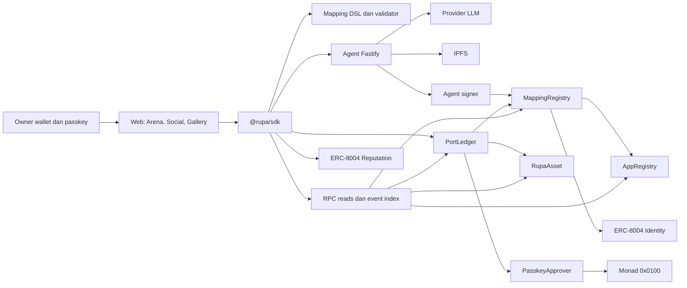
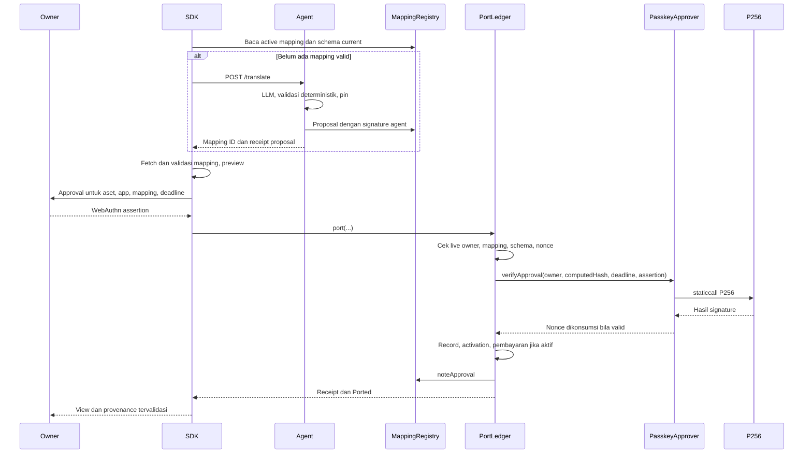

# Arsitektur

Status: rancangan MVP. Lihat [decision log](decisions.md) untuk detail yang belum dibekukan.

## Komponen

| Modul | Tanggung jawab | Bukan tanggung jawab |
| --- | --- | --- |
| `contracts/` | Otorisasi, registry, nonce, activation, provenance, fee | Menjalankan LLM atau membaca JSON dari IPFS |
| `packages/mapping-dsl/` | Parse, validasi, interpretasi deterministik | RPC, signing, provider credential |
| `packages/sdk/` | Discovery, verifikasi content, preview, WebAuthn, tx, provenance | Menyimpan private key agent/faucet |
| `services/agent/` | Fetch public input, LLM, validate, pin, propose | Menyetujui port untuk owner |
| `apps/web/` | UI demo dan docs consumer SDK | Mendefinisikan interpreter kedua atau melewati SDK validation |
| IPFS | Distribusi content immutable | Membuktikan kualitas mapping atau menjamin pinning selamanya |

## Data dan otoritas

| Entity | Data inti | Sumber otoritatif |
| --- | --- | --- |
| Asset | ID, owner, base, attrsHash, tokenURI | RupaAsset; external collection bila wrapper diaktifkan |
| App | admin, minter, payout, schema hash/URI, version, royalty bps | AppRegistry |
| Mapping | type, target, version, agent, content hash/URI, approvals, revoked | MappingRegistry + JSON yang cocok hash |
| Approval key | P256 qx/qy, credential hash, nonce | PasskeyApprover |
| Port | asset, from/to, mapping, agent, approver, timestamp, previous hash | PortLedger + block/event |
| Usage | app, asset, action tag, block/log position | Event Used yang diterima kontrak |
| Agent identity | agent ID, wallet, card | Existing ERC-8004 Identity |
| Reputation | score, count, evaluator, tags | Existing ERC-8004 Reputation; policy pemilihan di SDK |

Data JSON menggunakan versi schema eksplisit dan content hash. ID uint256 pada HTTP/JSON ditulis sebagai string desimal; TypeScript internal menggunakan `bigint`. Nomor app uint32 aman sebagai integer JSON. Konvensi string versi schema dijelaskan pada [mapping spec](mapping-dsl.md).

## Urutan port

Jika langkah di dalam transaksi gagal, semua perubahan termasuk nonce harus rollback. Preview dari SDK tidak menggantikan pemeriksaan state saat transaksi dieksekusi.

## Cache dan event index

- Key cache mapping menyertakan chain ID, alamat registry, asset type, target app, schema version, dan content hash. Pointer `activeMapping` onchain tetap perlu diperiksa terhadap schema/revoked.
- Cache proposal pending terpisah dari mapping aktif. Dedupe concurrent translation menggunakan tuple jenis aset/target/version dan kunci request idempotent.
- Index event dimulai dari deployment block; urutkan block number, transaction index, log index; dedupe log yang sama. Cache tidak boleh mencampur jaringan/deployment.
- Untuk aset native, replay event mint/transfer menghasilkan kandidat wallet, lalu baca live owner. Jangan mengasumsikan ERC721Enumerable tersedia.
- Reorg/receipt hilang membatalkan cache terkait. Simpan block hash pada checkpoint; rescan overlap berbatas bila tidak cocok.
- View dihitung kembali setelah event `Used`, perubahan schema, revoke, atau transfer. History WIN dihitung menurut app origin dan kebijakan di [mapping spec](mapping-dsl.md).

## Trust boundary

Browser boleh mengirim assertion dan transaksi; calldata tetap untrusted. LLM hanya menerima allowlist data publik dan schema, tanpa credential signer. Agent signer bekerja setelah validasi sukses. Registry permissionless dapat memuat proposal dari implementasi agent lain, sehingga validator SDK wajib berjalan pada content yang diunduh.

Aplikasi demo menjalankan admin mint/use di backend yang mengautentikasi sesi dan membatasi mint; endpoint agent publik tidak otomatis menjadi endpoint admin. Kontrak tetap memeriksa admin/minter. Desain game bukan bukti bahwa aktivitas offchain jujur.

## Topologi yang dituju

Satu web origin HTTPS melayani seluruh route dan passkey. Agent dapat di origin lain dengan CORS yang dibatasi ke origin demo; CORS bukan mekanisme autentikasi. Metadata/mapping berada di IPFS melalui gateway yang dikonfigurasi. Hosting dan domain belum ditetapkan; deployment ditunda. Development memakai fixture/local chain dengan label mock yang jelas, kemudian integration test RPC saat tahap M0/M1 implementasi.
